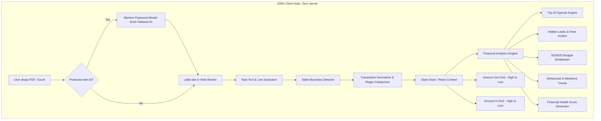

# M-Pesa Statement Analyzer — Project Plan & Technical Blueprint
**Stack Selected:** Option A — 100% Client-Side React (Vite + TypeScript + Mantine v7 + pdfjs-dist)

---

## 1. Project Vision & Core Principles

The M-Pesa Statement Analyzer is a **privacy-first, client-side personal finance tool** built to transform raw Safaricom M-Pesa statements into deep financial awareness.

### Foundational Principles:
1. **Zero-Server Privacy:** Financial statements and National ID passwords never leave the user's browser. Decryption, parsing, categorization, and analytics run 100% locally using Web Workers.
2. **Actionable Financial Responsibility:** Go beyond passive bookkeeping to actively uncover hidden financial leaks (Fuliza interest, airtime micro-spends, Safaricom tariffs, impulse weekend spikes) and provide a **Financial Wellness Score**.
3. **High-Performance Grids:** Fluid, searchable, virtualized Mantine grids ordering cash inflows and outflows from highest to lowest.

---

## 2. Technology Stack Definition (Option A)

```
┌────────────────────────────────────────────────────────────────────────┐
│                              FRONTEND                                  │
├────────────────────────────────────────────────────────────────────────┤
│ • Framework:         React 18 / 19 + TypeScript + Vite                 │
│ • UI System:         Mantine v7 (@mantine/core, @mantine/hooks)        │
│ • Data Grids:        Mantine React Table (MRT) / @tanstack/react-table │
│ • Data Visualization: Mantine Charts (@mantine/charts + Recharts)      │
│ • Icons:             Tabler Icons (@tabler/icons-react)                │
│ • Ingestion:         @mantine/dropzone                                 │
│ • File Export:       xlsx / jspdf / papaparse                          │
├────────────────────────────────────────────────────────────────────────┤
│                           PARSING ENGINE                               │
├────────────────────────────────────────────────────────────────────────┤
│ • PDF Extractor:     pdfjs-dist (running in a dedicated Web Worker)    │
│ • Decryption:        Native pdfjs-dist password callback               │
│ • Excel/CSV Support: SheetJS (xlsx)                                    │
│ • Regex Taxonomy:    Custom Safaricom M-Pesa detail categorizer        │
└────────────────────────────────────────────────────────────────────────┘
```

---

## 3. Financial Responsibility Analytics Engine

To empower users to be financially responsible, the analytics suite is structured into **7 core modules**:

```
┌──────────────────────────────────────────────────────────────────────────────────┐
│                      FINANCIAL RESPONSIBILITY MODULES                            │
├───────────────────────────────────┬──────────────────────────────────────────────┤
│ 1. The "Hidden Leaks" Auditor     │ • Fuliza & M-Shwari overdraft fee tracker    │
│                                   │ • Estimated Safaricom tariff & transfer fees │
│                                   │ • Micro-spending leakage (Airtime & Data)    │
├───────────────────────────────────┼──────────────────────────────────────────────┤
│ 2. Expense Classification         │ • Needs vs Wants (50/30/20 Rule)             │
│                                   │ • Fixed (Bills/Rent) vs Discretionary        │
├───────────────────────────────────┼──────────────────────────────────────────────┤
│ 3. Behavioral & Temporal Patterns │ • Weekend vs Weekday spending index          │
│                                   │ • Payday surge effect (days 1-5 post-salary) │
│                                   │ • Time-of-day impulse spending heatmap       │
├───────────────────────────────────┼──────────────────────────────────────────────┤
│ 4. Counterparty Concentration     │ • Top 20 highest individual spends           │
│                                   │ • Merchant concentration (Naivas, KPLC, etc) │
│                                   │ • P2P Money Sinks (Friends/Family sent to)   │
├───────────────────────────────────┼──────────────────────────────────────────────┤
│ 5. Cash Velocity & Runway         │ • Burn rate (Avg KES spend / day)            │
│                                   │ • Inflow vs Outflow ratio (Savings Rate)     │
│                                   │ • Projected runway based on ending balance   │
├───────────────────────────────────┼──────────────────────────────────────────────┤
│ 6. Financial Health Score (0-100) │ • Algorithmic score evaluating debt reliance,│
│                                   │   savings margin, fee drag, and consistency  │
├───────────────────────────────────┼──────────────────────────────────────────────┤
│ 7. Prescriptive Recommendations   │ • Actionable advice e.g. "Save KES 3,400 by  │
│                                   │   buying airtime via bank or monthly bundle" │
└───────────────────────────────────┴──────────────────────────────────────────────┘
```

### Deep Dive into Key Metrics:

#### A. The "Hidden Leaks" Tracker
* **Fuliza & Overdraft Reliance:** Detects `Fuliza M-Pesa facility fee` and `loan repayment`. Highlights total borrowed, total interest paid, and frequency of negative balance events.
* **Safaricom Fee Drag:** Many users don't realize how much they spend on transaction fees (withdrawal charges + P2P transfer bands + Paybill customer-side charges). Calculates total friction cost paid to telcos.
* **Airtime Micro-Spending Trap:** Identifies users buying KES 50–200 airtime 20+ times a month instead of scheduled monthly plans, quantifying total lost bulk discount.

#### B. The 50 / 30 / 20 Budget Analyzer (Needs vs Wants vs Savings)
* **Essential / Needs (Target: 50%):** Utilities (KPLC, Water, Internet), Groceries (supermarket Tills), Rent Paybills, Medical, School fees.
* **Discretionary / Wants (Target: 30%):** Bars, restaurants, entertainment, gaming/betting Paybills, miscellaneous shopping.
* **Savings / Debt Servicing (Target: 20%):** Bank deposits, SACCO Paybills, money market funds (MMF Paybills like CIC, Sanlam, Stanbic), Fuliza repayments.

#### C. Behavioral Insights (The "Weekend & Payday Effect")
* **Weekend Surge Index:** Compares Friday 5 PM - Sunday midnight spending vs Monday - Thursday. Flags lifestyle inflation over weekends.
* **Payday Spike:** Tracks the velocity of spend within 5 days of major income deposits.

#### D. Financial Health Score (0 to 100)
A holistic score calculated from 4 weighted pillars:
1. **Net Savings Rate (30 pts):** Inflow minus Outflow as a percentage of total Inflow.
2. **Debt & Overdraft Independence (25 pts):** Zero or low Fuliza / loan usage.
3. **Transaction Efficiency (20 pts):** Low ratio of transaction fees to total spends (consolidated transfers instead of fragmented ones).
4. **Expense Stability (25 pts):** Consistency of daily spend vs erratic spike behavior.

---

## 4. UI / UX Design & Component Layout

The interface uses a clean, responsive layout built with Mantine v7:

```
┌──────────────────────────────────────────────────────────────────────────────────┐
│ [Navbar / Header]   M-Pesa Financial Health & Statement Analyzer   [Dark/Light] │
├──────────────────────────────────────────────────────────────────────────────────┤
│ [Statement Hero Banner]                                                          │
│ Owner: John Doe (2547****890) | Period: 01 Jan 2024 - 31 Mar 2024                │
│ [Total In: KES 145,000] [Total Out: KES 132,000] [Net Saved: +KES 13,000]       │
│ [Financial Health Score: 78/100 - "Good"]                                        │
├──────────────────────────────────────────────────────────────────────────────────┤
│ [Navigation Tabs: SegmentedControl / Tabs]                                       │
│  [Overview & Health]  |  [Amount Out (Spends)]  |  [Amount In (Income)]          │
│                       |  [Top 20 Spends]        |  [Leaks & Fees]                │
├──────────────────────────────────────────────────────────────────────────────────┤
│ TAB CONTENT AREA:                                                                │
│                                                                                  │
│ [Amount Out Grid (Default: Highest -> Lowest)]                                   │
│ ┌────────────┬──────────────────┬─────────────────┬──────────┬────────┬────────┐ │
│ │ Receipt    │ Date & Time      │ Details         │ Category │ Amount │ Bal.   │ │
│ ├────────────┼──────────────────┼─────────────────┼──────────┼────────┼────────┤ │
│ │ QK192837   │ 2024-02-15 14:00 │ Paybill 522522  │ Bank/Rent│ 45,000 │ 12,000 │ │
│ │ QK987654   │ 2024-02-01 10:20 │ Buy Goods 12345 │ Grocery  │ 18,500 │ 57,000 │ │
│ └────────────┴──────────────────┴─────────────────┴──────────┴────────┴────────┘ │
└──────────────────────────────────────────────────────────────────────────────────┘
```

### Key Grid Capabilities (Mantine React Table)
- **Default Sort:** Amount descending ($\text{Highest} \rightarrow \text{Lowest}$).
- **Instant Search:** Fuzzy search across recipient name, Till/Paybill number, and account reference.
- **Filters:**
  - Category Badge selector (multi-select: Paybill, Till, P2P, Airtime, Fuliza, etc.).
  - Date Range calendar picker.
  - Amount range slider (e.g. Transactions over KES 1,000).
- **Row Highlighting:** Color-coded badges for easy visual recognition.
- **Export:** One-click CSV and Excel export of filtered or sorted rows.

---

## 5. Technical Architecture & Data Pipeline



---

## 6. Implementation Phasing & Next Steps

### Phase 1: Project Scaffolding
- Initialize Vite + React + TypeScript + Mantine v7.
- Install dependencies: `@mantine/core`, `@mantine/hooks`, `@mantine/dropzone`, `@mantine/charts`, `mantine-react-table`, `pdfjs-dist`, `tabler-icons-react`, `recharts`.
- Set up theme, dark mode, and responsive layout shell.

### Phase 2: PDF Parsing & Decryption Worker
- Implement `pdf-worker.ts` using `pdfjs-dist`.
- Build password retry handling (standard 10-digit / 8-digit National ID verification).
- Build parser for multi-line Safaricom statement tables and summary headers.
- Write unit tests against sample statement structures.

### Phase 3: Dual Searchable Grids (Amount Out & Amount In)
- Configure Mantine React Table with default Descending Amount Sort.
- Implement column formatting, category badges, and quick copy for receipt numbers.
- Add advanced filtering (Date Range, Min/Max Amount, Category, Search).

### Phase 4: Financial Responsibility & Analytics Dashboard
- Build KPI stat cards (Net Flow, Savings Rate, Total Fees, Fuliza Spent).
- Build Top 20 Spends Leaderboard with visual progress bars.
- Build Interactive Charts (Spending by Category, Weekend vs Weekday, Daily Spend Trend).
- Calculate and display the **Financial Health Score** with actionable tips.

### Phase 5: Exporting & Offline Optimization
- Support CSV/Excel export of categorized transactions.
- Implement PWA (Progressive Web App) manifest for offline desktop/mobile use.
